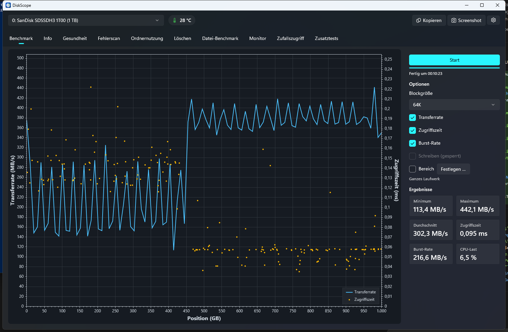
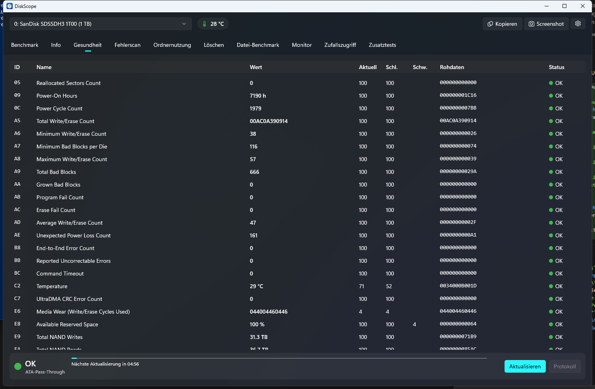
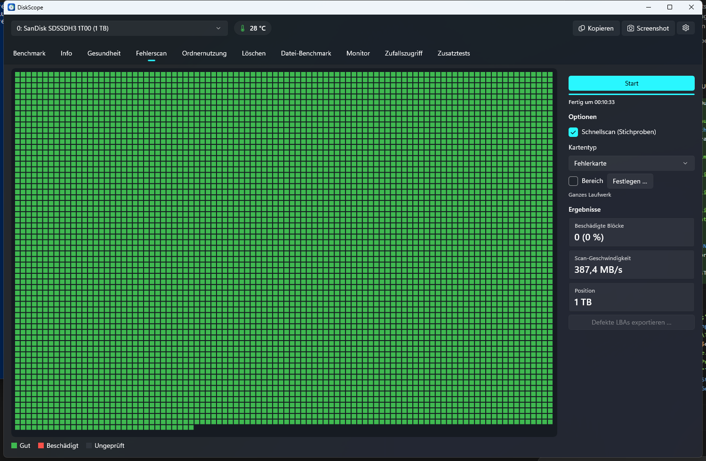
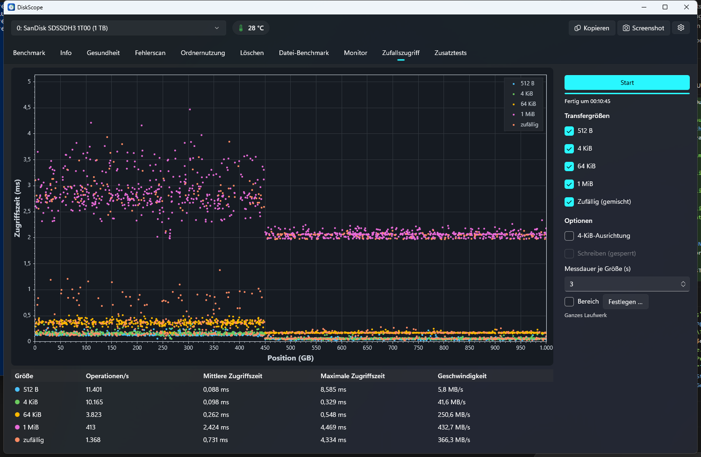

# DiskScope

Open-Source-Werkzeug für Windows zur Analyse, Bewertung und Überwachung von Laufwerken (HDD, SATA-SSD, NVMe, USB).
C# / .NET 10, Oberfläche in WinUI 3, dazu eine CLI. Spezifikation: [SPEC.md](SPEC.md). Lizenz: MIT.
Entwickelt von Syntaxo.



## App

`src/DiskScope.App` ist eine unverpackte, self-contained WinUI-3-App (MVVM mit CommunityToolkit.Mvvm, DI).
Kopfzeile mit Laufwerksauswahl, Temperatur (Farbe nach Warnschwelle), „Ergebnisse kopieren“, „Screenshot speichern“
und Einstellungen (`%APPDATA%\DiskScope\settings.json`). Tabs Benchmark, Info, Gesundheit, Fehlerscan und
Zufallszugriff, Ordnernutzung, Datei-Benchmark, Monitor (ETW) und Zusatztests sind fertig; „Löschen“ folgt mit den
Schutzregeln. Diagramme mit ScottPlot.WinUI, das Blockraster mit Win2D. „Übersicht“ öffnet ein kompaktes Statusfenster
aller Laufwerke; bei einem Wechsel des Gesundheitsstatus erscheint eine Windows-Benachrichtigung. Ergebnisse lassen sich
kopieren, als JSON exportieren und als Screenshot speichern (optional automatisch nach jedem Test). Der Gesundheits-Tab
bietet SMART-Selbsttests (ATA/SATA) und ein Protokoll der Werteänderungen.
Ohne Adminrechte startet die App normal und bietet „Als Administrator neu starten“ an.

| Gesundheit | Fehlerscan | Zufallszugriff |
|---|---|---|
|  |  |  |

## Aufbau

| Projekt | Inhalt |
|---|---|
| `src/DiskScope.Core` | Gerätezugriff (CsWin32), Parser, Datenmodelle; `unsafe` nur in `Native/` |
| `src/DiskScope.Cli` | Konsolen-App `diskscope` |
| `src/DiskScope.App` | WinUI-3-App (unverpackt, self-contained) |
| `tests/DiskScope.Core.Tests` | Unit-Tests mit synthetischen Gerätepuffern |
| `tests/DiskScope.Integration.Tests` | Lesende Tests gegen echte Laufwerke, später VHD-Tests |

## Bauen und prüfen

```
dotnet build -warnaserror
dotnet test
dotnet format --verify-no-changes
```

Tests laufen über Microsoft.Testing.Platform (siehe `global.json`).

## CLI

```
diskscope list [--json]
diskscope info <drive> [--json]
diskscope smart <drive> [--json]
diskscope bench <drive> [--block 64K] [--range 0-100] [--points 100] [--json]
diskscope random <drive> [--sizes 512,4K,64K,1M,random] [--align4k] [--range 0-100] [--duration 3s] [--json]
diskscope scan <drive> [--quick] [--range 0-100] [--blocks 10000] [--export bad.csv|bad.json] [--json]
diskscope extra <drive> [--tests Random4K,Butterfly,…] [--align4k] [--range 0-100] [--cache] [--json]
diskscope filebench <volume> [--size 500M] [--pattern zero|random] [--qd 32] [--blocks] [--json]
diskscope monitor <drive> [--duration 10s] [--json]
diskscope smart <drive> --selftest short|extended|abort|status
diskscope erase <drive> [--range] [--pattern zero|random|0xAA] [--passes n] [--verify] [--dismount] (--dry-run | --i-understand-data-loss <seriennummer>)
diskscope bench|random|extra <drive> --write … (--dry-run | --i-understand-data-loss <seriennummer>)
diskscope aam|apm <drive> [--set <stufe>|off --confirm]
diskscope temp [--watch 60s] [--fahrenheit] [--json]
```

Alle Befehle verstehen `--verbose` (Protokoll zusätzlich auf stderr). Protokolle liegen rotierend in
`%APPDATA%\DiskScope\logs`, Seriennummern darin maskiert.

### S.M.A.R.T.

| Laufwerk | Ohne Admin | Mit Admin |
|---|---|---|
| NVMe | vollständiges SMART/Health-Log | dasselbe |
| SATA | Attributwerte aus `IOCTL_STORAGE_PREDICT_FAILURE`, ohne Schwellwerte | ATA-Pass-Through mit Schwellwerten und SMART-Status |
| USB (SAT) | nur Ja/Nein-Status | ATA PASS-THROUGH (16) |

Bewertungsregeln: siehe `SmartEvaluator` in `src/DiskScope.Core/Smart`. Attributnamen: `src/DiskScope.Core/Data/smart-attributes.json`.
Abgleich mit Windows: `tools/Compare-SmartCounters.ps1` (als Administrator).

### Benchmarks

`bench` und `random` lesen ungepuffert (`FILE_FLAG_NO_BUFFERING`) und brauchen Adminrechte. Zufallspositionen
werden je Lauf neu gewählt, damit der Laufwerks-Cache einen vorherigen Lauf nicht wiederholen kann; vor Latenzmessungen
laufen 32 ungezählte Aufwärm-Zugriffe. `--range` nimmt Prozent (`10-50`) oder GB (`10GB-200GB`).

### Schreibende Operationen (Schutzregeln)

Alle Schreibzugriffe auf Rohgeräte liegen in `DiskScope.Core.Destructive` und brauchen eine `WriteAuthorization`
von `WriteGuard` (ein Architekturtest prüft, dass kein anderer Namensraum schreibt):

- Das System-/Boot-Laufwerk wird nie beschrieben, ohne Ausnahme.
- Laufwerke mit Volumes nur nach ausdrücklichem Aushängen (`--dismount` bzw. Option in der App); die Volumes bleiben
  während der Operation gesperrt.
- Bestätigung: in der App durch Eintippen der Modellbezeichnung, in der CLI mit `--i-understand-data-loss <seriennummer>`.
- `--dry-run` bzw. „Probelauf“ zeigt Bereich, LBAs und betroffene Volumes, ohne zu schreiben.
- Das Laufwerk wird für jede Entscheidung neu gelesen; geschrieben wird nur innerhalb des freigegebenen Bereichs.
- AAM/APM (SET FEATURES) sind auf genau diese Einstellungen beschränkt und brauchen eine Bestätigung.

### Admin-Prüfungen

```
tools/Invoke-AdminChecks.ps1 -Root <repo> -Drives "0 1"
```

Legt eine Test-VHD an (diskpart, `%TEMP%\DiskScopeTests`), führt die Tests der Kategorie `Admin` aus, misst die
angegebenen Laufwerke je zweimal lesend und schreibt die Berichte nach `artifacts/`.

`<drive>` ist die PhysicalDrive-Nummer. Exit-Codes: 0 OK, 1 Fehler, 2 fehlende Rechte, 3 Gesundheitswarnung.

`list` und `info` funktionieren ohne Administratorrechte: IDENTIFY-Daten (ATA) und Identify Controller (NVMe)
werden über `IOCTL_STORAGE_QUERY_PROPERTY` (protokollspezifische Abfrage) gelesen. Nur wenn der Treiber das nicht
unterstützt, fällt DiskScope auf `IOCTL_ATA_PASS_THROUGH` zurück; das braucht Adminrechte und einen Handle mit
Schreibzugriff, wird aber nur für lesende Befehle (IDENTIFY, SMART lesen) zugelassen.
